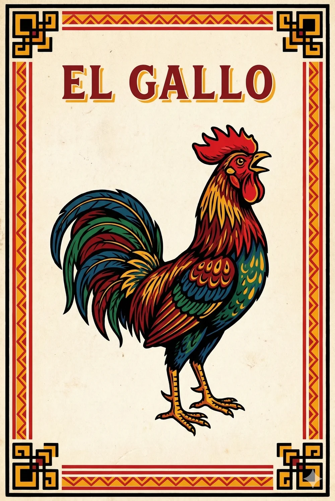
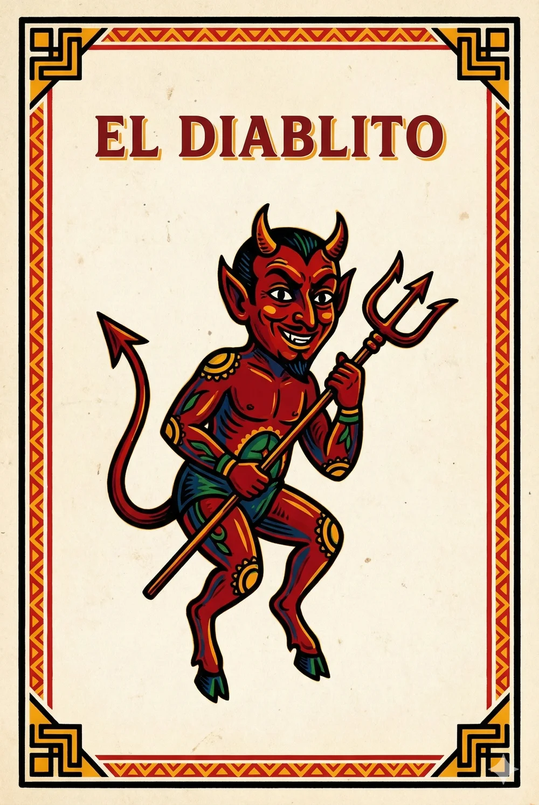
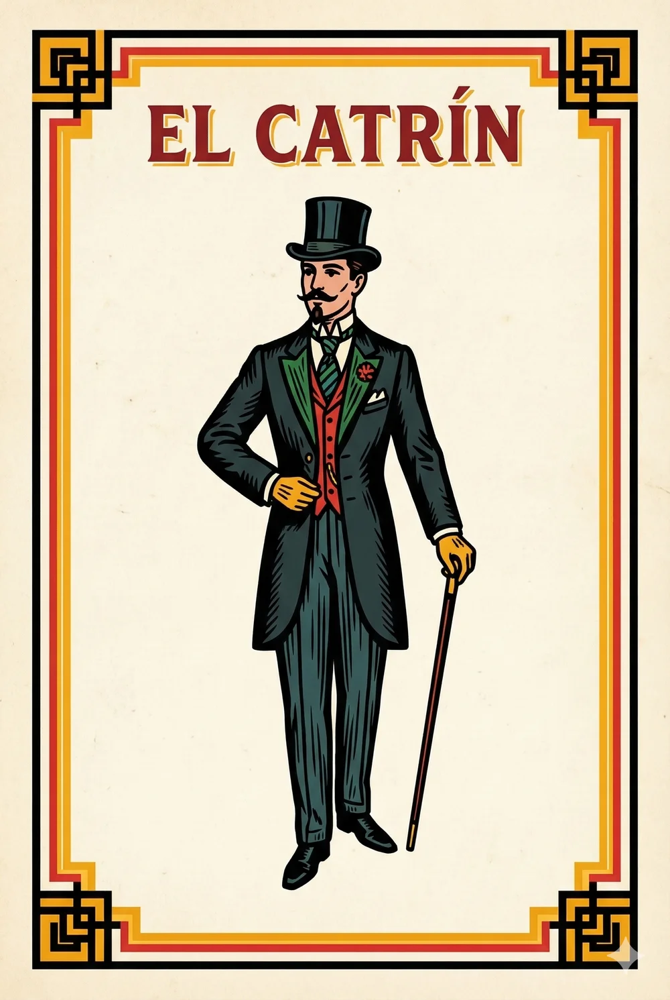

# 🎴 Lotería Mexicana — AI Prompts & Template Generator

[](./LICENSE)
[](https://play.google.com/store/apps/details?id=com.perales.tuloteria)
[](./prompts/cartas)

Colección abierta de **los 54 prompts estructurados** y un **generador en Node.js** para crear una baraja completa de **Lotería Mexicana tradicional** utilizando modelos de generación de imágenes por IA (**Google Gemini / Imagen 3, ChatGPT / DALL·E 3, Midjourney, Stable Diffusion o Flux**).

Cada prompt está diseñado para mantener **coherencia visual absoluta en las 54 cartas** (marco doble negro y dorado-ámbar `#FFC409`, textura de impresión tipográfica artesanal de mediados del siglo XX, ilustración folclórica naïf y proporción 2:3) sin infringir marcas comerciales registradas.

---

## 🖼️ Ejemplos de Resultados Generados

Estas cartas fueron generadas directamente con los prompts de este repositorio e integradas en la app móvil **[Tu Lotería Mexicana](https://play.google.com/store/apps/details?id=com.perales.tuloteria)**:

| 1. El Gallo | 2. El Diablito | 4. El Catrín |
| :---: | :---: | :---: |
|  |  |  |
| [Ver prompt (`el-gallo.md`)](./prompts/cartas/el-gallo.md) | [Ver prompt (`el-diablito.md`)](./prompts/cartas/el-diablito.md) | [Ver prompt (`el-catrin.md`)](./prompts/cartas/el-catrin.md) |

---

## 🚀 Cómo usar los prompts

### Opción 1: Copiar y pegar directamente (Listos para usar)
Entra a la carpeta [`prompts/cartas/`](./prompts/cartas/) o usa la [tabla completa de las 54 cartas](#-índice-de-las-54-cartas-tradicionales) más abajo, abre la carta que quieras generar y copia el contenido en tu generador de imágenes favorito (Gemini, ChatGPT, Midjourney, etc.).

### Opción 2: Personalizar la plantilla maestra y regenerar los 54 prompts
Si quieres cambiar la paleta de colores, el estilo del marco, el formato de aspecto o el estilo artístico para toda la baraja de un solo golpe:

1. Edita la plantilla base en [`prompt-imagenes.md`](./prompt-imagenes.md) (usa los marcadores `[NOMBRE DE LA CARTA]` y `[DESCRIPCIÓN DETALLADA DEL ÍCONO]`).
2. Si deseas ajustar la descripción de alguna figura en particular, edita el arreglo `cards` en [`scripts/generate-loteria-prompts.js`](./scripts/generate-loteria-prompts.js).
3. Ejecuta el generador con Node.js (no requiere dependencias externas):

```bash
npm run generate
# o directamente:
node scripts/generate-loteria-prompts.js
```

Esto actualizará automáticamente los **54 archivos `.md`** dentro de `prompts/cartas/`.

---

## 📋 Índice de las 54 Cartas Tradicionales

| # | Carta | Prompt Markdown | # | Carta | Prompt Markdown |
| :-: | :--- | :--- | :-: | :--- | :--- |
| **1** | El Gallo | [`el-gallo.md`](./prompts/cartas/el-gallo.md) | **28** | La Sandía | [`la-sandia.md`](./prompts/cartas/la-sandia.md) |
| **2** | El Diablito | [`el-diablito.md`](./prompts/cartas/el-diablito.md) | **29** | El Tambor | [`el-tambor.md`](./prompts/cartas/el-tambor.md) |
| **3** | La Dama | [`la-dama.md`](./prompts/cartas/la-dama.md) | **30** | El Camarón | [`el-camaron.md`](./prompts/cartas/el-camaron.md) |
| **4** | El Catrín | [`el-catrin.md`](./prompts/cartas/el-catrin.md) | **31** | Las Jaras | [`las-jaras.md`](./prompts/cartas/las-jaras.md) |
| **5** | El Paraguas | [`el-paraguas.md`](./prompts/cartas/el-paraguas.md) | **32** | El Músico | [`el-musico.md`](./prompts/cartas/el-musico.md) |
| **6** | La Sirena | [`la-sirena.md`](./prompts/cartas/la-sirena.md) | **33** | La Araña | [`la-arana.md`](./prompts/cartas/la-arana.md) |
| **7** | La Escalera | [`la-escalera.md`](./prompts/cartas/la-escalera.md) | **34** | El Soldado | [`el-soldado.md`](./prompts/cartas/el-soldado.md) |
| **8** | La Botella | [`la-botella.md`](./prompts/cartas/la-botella.md) | **35** | La Estrella | [`la-estrella.md`](./prompts/cartas/la-estrella.md) |
| **9** | El Barril | [`el-barril.md`](./prompts/cartas/el-barril.md) | **36** | El Cazo | [`el-cazo.md`](./prompts/cartas/el-cazo.md) |
| **10** | El Árbol | [`el-arbol.md`](./prompts/cartas/el-arbol.md) | **37** | El Mundo | [`el-mundo.md`](./prompts/cartas/el-mundo.md) |
| **11** | El Melón | [`el-melon.md`](./prompts/cartas/el-melon.md) | **38** | El Apache | [`el-apache.md`](./prompts/cartas/el-apache.md) |
| **12** | El Valiente | [`el-valiente.md`](./prompts/cartas/el-valiente.md) | **39** | El Nopal | [`el-nopal.md`](./prompts/cartas/el-nopal.md) |
| **13** | El Gorrito | [`el-gorrito.md`](./prompts/cartas/el-gorrito.md) | **40** | El Alacrán | [`el-alacran.md`](./prompts/cartas/el-alacran.md) |
| **14** | La Muerte | [`la-muerte.md`](./prompts/cartas/la-muerte.md) | **41** | La Rosa | [`la-rosa.md`](./prompts/cartas/la-rosa.md) |
| **15** | La Pera | [`la-pera.md`](./prompts/cartas/la-pera.md) | **42** | La Calavera | [`la-calavera.md`](./prompts/cartas/la-calavera.md) |
| **16** | La Bandera | [`la-bandera.md`](./prompts/cartas/la-bandera.md) | **43** | La Campana | [`la-campana.md`](./prompts/cartas/la-campana.md) |
| **17** | El Bandolón | [`el-bandolon.md`](./prompts/cartas/el-bandolon.md) | **44** | El Cantarito | [`el-cantarito.md`](./prompts/cartas/el-cantarito.md) |
| **18** | El Violoncello | [`el-violoncello.md`](./prompts/cartas/el-violoncello.md) | **45** | El Venado | [`el-venado.md`](./prompts/cartas/el-venado.md) |
| **19** | La Garza | [`la-garza.md`](./prompts/cartas/la-garza.md) | **46** | El Sol | [`el-sol.md`](./prompts/cartas/el-sol.md) |
| **20** | El Pájaro | [`el-pajaro.md`](./prompts/cartas/el-pajaro.md) | **47** | La Corona | [`la-corona.md`](./prompts/cartas/la-corona.md) |
| **21** | La Mano | [`la-mano.md`](./prompts/cartas/la-mano.md) | **48** | La Chalupa | [`la-chalupa.md`](./prompts/cartas/la-chalupa.md) |
| **22** | La Bota | [`la-bota.md`](./prompts/cartas/la-bota.md) | **49** | El Pino | [`el-pino.md`](./prompts/cartas/el-pino.md) |
| **23** | La Luna | [`la-luna.md`](./prompts/cartas/la-luna.md) | **50** | El Pescado | [`el-pescado.md`](./prompts/cartas/el-pescado.md) |
| **24** | El Cotorro | [`el-cotorro.md`](./prompts/cartas/el-cotorro.md) | **51** | La Palma | [`la-palma.md`](./prompts/cartas/la-palma.md) |
| **25** | El Borracho | [`el-borracho.md`](./prompts/cartas/el-borracho.md) | **52** | La Maceta | [`la-maceta.md`](./prompts/cartas/la-maceta.md) |
| **26** | El Negrito | [`el-negrito.md`](./prompts/cartas/el-negrito.md) | **53** | El Arpa | [`el-arpa.md`](./prompts/cartas/el-arpa.md) |
| **27** | El Corazón | [`el-corazon.md`](./prompts/cartas/el-corazon.md) | **54** | La Rana | [`la-rana.md`](./prompts/cartas/la-rana.md) |

---

## 📱 Pruébalo en vivo en Android

¿Quieres ver las 54 cartas en acción con voz de **El Gritón** en español mexicano, versos tradicionales y cartones interactivos con frijolitos?

👉 **[Descargar Tu Lotería Mexicana en Google Play](https://play.google.com/store/apps/details?id=com.perales.tuloteria)**

Explora más aplicaciones de **[Israel Perales en Google Play](https://play.google.com/store/apps/developer?id=Israel+Perales)**.

---

## ⚖️ Nota sobre Dominio Público y Derechos de Autor

El juego de la Lotería Mexicana, sus reglas y la lista tradicional de 54 personajes y objetos pertenecen al dominio público y al folclore tradicional mexicano. Estos prompts están diseñados para producir **reinterpretaciones artísticas originales** inspiradas en la gráfica popular mexicana de mediados del siglo XX, sin reproducir trazos protegidos ni utilizar marcas registradas de terceros.

Distribuido bajo la licencia [MIT](./LICENSE). ¡Siéntete libre de hacer *fork*, adaptar los prompts y crear tu propia baraja!
